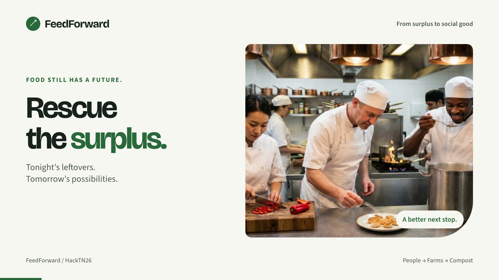
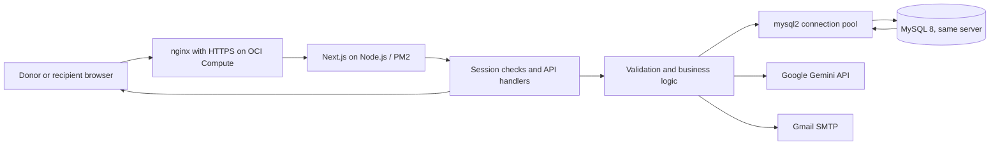

# FeedForward

Route surplus food to its best use: **people first, then farms, then compost.**
Built at HackTN 2026 in Nashville for Challenge #1: *From Surplus to Social Good.*

FeedForward is a working food-recovery prototype, now being tested with
restaurants and recipient organizations in Bowling Green and South Central
Kentucky. Kitchens describe surplus in plain words and AI drafts the listings;
community organizations reserve eligible food; completed pickups feed a
database-backed impact dashboard.

**Live demo:** https://feedforward.brentoncodes.dev

## Product video

[](brag-output/LeftoverLegends.mp4)

[Watch LeftoverLegends.mp4](brag-output/LeftoverLegends.mp4) — a 24-second narrated
walkthrough of posting surplus food and reserving a pickup.

## The problem

Kitchens need to communicate what is available, who can accept it, and when it
can be collected. Pantries, shelters, farms, and compost sites have different
needs and pickup schedules. FeedForward brings those details into one workflow
and records the handoff, rather than counting an offer as a completed donation.

## What works today

| Feature | Implementation |
| --- | --- |
| Donor listings | Reviewed manual entry, database persistence, and posted-food status |
| Recipient matching | Up to three suggestions based on accepted tiers, refused categories, and configured pickup windows; estimated ZIP-based distance where available |
| Reservations | Whole-listing bookings with saved history and duplicate protection |
| Pickup confirmation | Actual weight recording, recipient ownership checks, and inventory updates |
| Impact reporting | Completed pickup counts, weight by destination, recent history, and estimated meals from people-tier pounds |
| AI listing drafts | A donor's plain-language description becomes editable draft listings through Google's Gemini API with a JSON response schema; FeedForward's own rules suggest each item's destination, and the donor confirms every field before posting |
| Pilot surveys | Separate donor and recipient surveys with follow-up questions; each response is validated and emailed to the team, and nothing is stored on the server |

**Demo scope:** sign-in selects a predefined Bowling Green demo organization; it
is not production authentication. Any listings and dashboard totals are test
entries, not verified community impact. Production authentication remains future
work. Ratings are a coming-soon preview.

## How it works

1. A donor describes tonight's surplus in plain words, or adds items by hand. Gemini drafts a listing for each food: name, quantity, estimated weight, condition, category, and whether it contains meat.
2. FeedForward's tier rules suggest a destination for each item: **1 · People**, **2 · Animals**, or **3 · Compost**. The donor can change it.
3. Server-side validation checks the details and rejects incompatible choices, such as meat-containing items for animal feed. The donor reviews and confirms before saving.
4. The donor can view suggested recipients for a saved listing. Recipients see food permitted by their own acceptance rules, with bookable pickup times.
5. A recipient reserves the entire listing. The reservation persists after refresh, and the food is hidden from other recipients.
6. At collection, the recipient confirms actual weight. The backend records completion, the database updates inventory, and the impact dashboard reads the saved results.

**Trust principle:** the AI only describes the food. Explicit rules suggest where
it goes, server-side validation checks every field, and the donor confirms before
anything is saved. The AI never certifies food safety. Suggested recipients are
registered demo organizations, not evidence of an implemented external
verification process.

## Team

| Role | Name |
| --- | --- |
| Herder: Project lead | Amber Eckler |
| Hustler: Business and pitch | Meklit Sitotaw |
| Hacker / Hipster: Backend APIs, frontend integration, and testing | Manas Tiwari |
| Hacker: Frontend, design, and deployment | Brenton Hippler |
| Hacker: Database and backend | Niranjan Sharma |

**Who built what:** all code through October 18, 2026, the end of HackTN26, was
built by the team above. Since October 19, the code has been edited, updated and
extended by Brenton Hippler, including the move to Oracle Cloud's Always Free tier
with HTTPS, the pilot surveys, AI listing drafts with Gemini, and the Bowling Green
localization. Manas Tiwari also contributed README updates after the hackathon.
The commit history shows the details.

## Technology stack

| Layer | Technology and use |
| --- | --- |
| Application | Next.js 16 App Router and React 19; frontend and backend in one deployment |
| Languages | TypeScript for application logic; SQL for persistence and reporting |
| Frontend | Tailwind CSS v4, responsive forms, and accessible status/error feedback |
| Backend | Node.js and Next.js route handlers; JSON APIs with server-side validation |
| Database access | `mysql2/promise` for parameterized SQL and connection pooling; Drizzle ORM for typed schema/relations and selected queries |
| Database tooling | Drizzle Kit introspection, SQL schema, and explicit migration scripts |
| OCI deployment | OCI Always Free Ampere A1 Compute (ARM) running Oracle Linux 9, nginx reverse proxy with Let's Encrypt HTTPS, and PM2 process management |
| Persistence | MySQL 8.0 on the application server, accepting local connections only, with nightly backups |
| Quality checks | Node.js test runner, ESLint, TypeScript, and GitHub Actions |
| AI | Google Gemini API (`gemini-3.5-flash-lite`, free tier) with structured JSON output for listing drafts; the model is set by environment variable |
| Email | Nodemailer over Gmail SMTP for survey responses |

## Architecture and data flow



nginx receives public HTTPS traffic on port 443 using a Let's Encrypt certificate
(port 80 redirects to HTTPS) and forwards it to Next.js on port 3000. MySQL runs
on the same server and accepts only local connections; the browser never connects
directly to the database. The application's database user can read and write rows
but cannot change the schema; migrations run under a separate admin account.
Database credentials come from server-side environment variables. The pool reuses
up to five connections. The database is backed up nightly. Listing drafts call
the Gemini API from the server with a 30-second timeout; the API key stays in
server-side environment variables. Survey responses are sent by email through
Gmail SMTP and are not written to the database or logs.

The core data model is:

```text
Organization → Donor → Item
Organization → Recipient → Claim → Pickup
                              ↑
                             Item
```

Recipient preferences live in `AcceptedTier`, `RefusedCategory`, and
`AcceptanceRule`; `Category` provides food classifications. See
[DB_DESIGN.md](DB_DESIGN.md) for the ERD and
[database/README.md](database/README.md) for setup and API behavior.

## Backend engineering

- **Transactions and locking:** reservation and completion operations lock the
  item before checking/writing related records. Errors roll back the transaction
  and connections are released. Unique constraints allow one claim per listing
  and one completed pickup per claim.
- **Inventory changes at collection:** a claim reserves food without decrementing
  stock. Pickup insertion invokes a whole-listing guard and the existing inventory
  trigger. Application code does not independently decrement stock a second time.
- **Session-derived ownership:** listing creation, reservations, matching, and
  pickup completion use the organization selected in the session. Request fields
  cannot override that identity. This is authorization within the demo identity
  model, not a replacement for real authentication.
- **Explainable matching:** queries filter recipients by accepted tier and refused
  category, require pickup windows, and rank by approximate ZIP-based distance
  when known. The booking endpoint performs final time-window and expiry checks.
  Viewing a suggestion does not assign food or create a claim.
- **Time handling:** availability is stored and exchanged in UTC. Recipient
  schedules are evaluated in `America/Chicago`, including overnight windows and
  daylight-saving changes. The backend clock is checked after lock waits.
- **Reporting from completed handoffs:** impact joins `Pickup → Claim → Item`.
  Recorded weight takes priority; historical unmeasured pickups use collected
  quantity × unit weight, rather than remaining inventory. Reporting is all-time;
  recipients see their own received pickups, while donors and anonymous visitors
  see labeled platform totals. Meal equivalents are estimates, not counted meals.
- **Uncertain-response recovery:** the UI reloads saved reservations after a write
  attempt instead of automatically repeating a POST that may already have committed.
- **Shared contracts:** TypeScript types connect API responses and frontend
  components, while runtime validation checks untrusted request bodies.
- **AI drafts, rules decide:** Gemini returns structured facts about each food,
  never a destination. `lib/tiers.ts` applies the EPA Wasted Food Scale: edible
  food goes to people unless cooked food has been out over two hours; plant-based
  scraps go to animals, never pigs; anything with meat goes to compost.
  `lib/extract.ts` validates every returned field, treats unsure meat as meat,
  and leaves unknown weights and conditions blank for the donor.
- **Rate limits:** AI drafting allows 10 requests per hour per visitor and 400 per
  day site-wide, under Gemini's free limit of 500. Surveys allow 5 per hour per
  visitor, with a honeypot field for bots.

## API

| Endpoint | Input / scope | Result |
| --- | --- | --- |
| `POST /api/listings` | `{ confirmed: true, listings: [...] }`; donor from session | Saved listings |
| `GET /api/listings` | Optional `?tier=1`, `2`, or `3`; identity from session | Own donor listings or eligible recipient listings with pickup slots |
| `GET /api/matches?listingId=...` | A listing owned by the donor | Up to three recipient suggestions |
| `POST /api/claims` | `{ listingId, pickupTime }`; recipient from session | Saved whole-listing reservation |
| `GET /api/claims` | Signed-in recipient | Saved reservations and completion status |
| `POST /api/pickups` | `{ claimId, actualLbs }`; reservation owner | Completed pickup with recorded weight |
| `GET /api/impact` | Recipient-specific or platform scope derived from session | Totals, destination breakdown, estimated meals, and recent pickups |
| `GET /api/health` | Connectivity check | Database availability |
| `POST /api/extract` | `{ text }`, up to 3,000 characters; signed-in donor | Draft listings with suggested tiers (not saved) |
| `POST /api/survey` | `{ kind: "donor" \| "recipient", answers }` | Validated response emailed to the team; nothing stored |

Operational responses use `Cache-Control: no-store`. Errors return JSON with an
`error` message and relevant status: 400 invalid input, 401 signed out, 403 denied,
404 missing reservation/listing, 409 conflict or unavailable completion, or 503
unexpected operational/database failure. The health endpoint uses 500 on failure.

Response contracts are in
[types/index.ts](types/index.ts); policy logic is in
[lib/listing-input.ts](lib/listing-input.ts),
[lib/tiers.ts](lib/tiers.ts),
[lib/claim-policy.ts](lib/claim-policy.ts), and
[lib/pickup-policy.ts](lib/pickup-policy.ts).

## Local setup

Use Node.js 24 to match CI.

```bash
git clone https://github.com/brenthippler-art/FeedForward.git
cd FeedForward
npm ci
```

Create `.env.local` with credentials for a reachable development database:

```dotenv
DB_HOST=
DB_USER=
DB_PASSWORD=
DB_NAME=hacktn

# AI listing drafts (Google AI Studio key, no billing account)
GEMINI_API_KEY=
GEMINI_MODEL=gemini-3.5-flash-lite

# Survey email (Gmail app password)
SMTP_USER=
SMTP_PASS=
SURVEY_TO=
```

The production database runs on the application server and accepts only local
connections, so it is not reachable from a laptop. For local development, use a
separate local MySQL instance with the required schema and migrations. See
[database setup](database/README.md) and [db/schema.sql](db/schema.sql). Do not
run schema or seed scripts against the production database without coordinating
with the team; `db/seed.ts` resets data.

```bash
npm run dev
```

Open http://localhost:3000. AI drafting and the surveys work without a database
once their keys are set. Listings, reservations, pickups, and impact require a
database connection and do not fall back to mock data when database requests fail.

## Testing and accessibility

```bash
node --test tests/*.test.mjs
npx tsc --noEmit
npm run lint
npm run build
```

GitHub Actions runs dependency installation, ESLint, type checking, and the
production build on PRs targeting `main` and pushes to `main`. The Node test suite
is run separately; it is not currently a CI step.

Tests cover validation, role/ownership checks, pickup windows, reservation and
completion errors, transaction behavior with isolated database doubles, migration
preflight, and impact scoping. They do not replace testing SQL, triggers, and
concurrency against MySQL. Browser checks exercise mobile layouts, draft editing,
completion, retry states, and lost-response recovery with controlled API fixtures.

The interface includes labeled inputs, status announcements, focus management,
a skip link, and touch-friendly controls. The team also exercised the core
post → reserve → collect → impact workflow on the live deployment.

## Deployment

On the OCI application server, the deploy helper is:

```bash
~/deploy.sh
```

It pulls updates from `main`, installs dependencies, builds the application, and
restarts its PM2 process, stopping before the restart if any step fails. The helper
is not tracked in this repository. A fresh deployment needs Node.js, nginx, PM2,
MySQL, environment variables, and a TLS certificate configured. Database migrations
are explicit operations run with the admin account, not automatic startup work.

## Next steps

- Draft listings from a photo of surplus food, using the same Gemini model and validation.
- Reset demo data nightly and add a demo banner for survey participants.
- Replace demo sign-in with production authentication and organization onboarding.
- Implement recipient verification and the currently preview-only ratings flow.
- Add cancellation and listing lifecycle changes with matching database rules.

## Sources and scope

FeedForward provides handling guidance and requires human confirmation; it does
not certify food safety or make legal determinations. Demo data and estimated meal
equivalents should not be presented as verified real-world outcomes.

- [USDA APHIS: Swine Health Protection Act and human food waste](https://www.aphis.usda.gov/sites/default/files/shpa-human-food-waste-and-swine.pdf)
- [CHLPI: Food Donation Improvement Act](https://chlpi.org/news-and-events/news-and-commentary/food-law-and-policy/new-federal-food-donation-law-seen-as-welcome-and-overdue/)
- [Modern Farmer: Kentucky food donation law (2017)](https://modernfarmer.com/2017/05/kentucky-food-immunity-bill/)